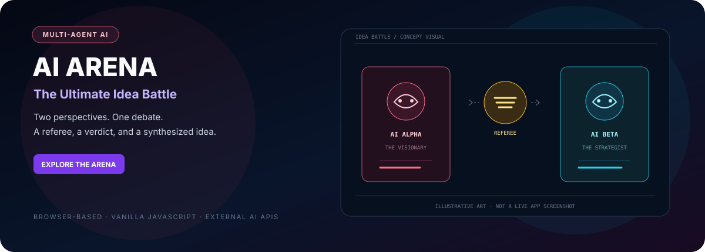

# ⚔️ AI ARENA
### The Ultimate Idea Battle

Concept artwork — not a live application screenshot.

  
  
  
  

**A browser-based debate arena where two AI perspectives argue a topic, a referee evaluates the discussion, and the experience can synthesize a closing idea.**

[Open repository](https://github.com/computerengineer1/ai-vs-ai) · [Quick Start](#-quick-start) · [API keys and security](#-api-keys-and-security) · [Project structure](#-project-structure)

---

## Overview

AI Arena is a static single-page web app built with HTML, CSS, and vanilla JavaScript. It presents two AI roles—**Alpha**, the visionary perspective, and **Beta**, the strategist—alongside a referee/arbiter. Users can provide opposing ideas, choose a language and model, follow the debate transcript, export the discussion, and review the generated verdict. A synthesis mode can attempt to combine the strongest parts of the competing concepts.

The interface includes a cinematic introduction video stored in the repository, language selection, debate presets, audio controls, voice configuration, and animated visual feedback.

## ✨ Features

- Two opposing AI roles with separate prompts and visual identity.
- Debate-generation and referee-verdict flow using a Groq-compatible chat-completions endpoint.
- Debate modes for a head-to-head result and a synthesized concept.
- Multilingual prompt and UI configuration.
- Configurable language and AI model selection.
- Optional speech integrations and browser voice fallback paths depending on provider/key availability.
- Transcript display with copy/export actions.
- Preset topics, dramatic intro video, progress/status UI, and result cards.
- Responsive dark interface with custom CSS and Tailwind loaded from a CDN.

## 🖼️ Cinematic introduction

The repository includes **ai VS ai website/0912.mp4**, used by the cinematic introduction layer. It is a local asset; the page should be served over HTTP so the browser can request it normally.

## 🏗️ Architecture

~~~mermaid
flowchart TD
    U["Browser UI"] --> I["Topic, perspectives, language, and model"]
    I --> G["Groq chat-completions API"]
    G --> A["Alpha / Beta debate turns"]
    A --> R["Referee / verdict"]
    R --> S["Winner and score summary"]
    R --> Y["Optional synthesis mode"]
    A --> T["Transcript feed"]
    T --> X["Copy / export"]
    V["Optional speech provider APIs and browser speech"] --> U
    M["Local intro video + CSS animation"] --> U
    K["Browser localStorage for entered API settings"] --> U
~~~

## 🚀 Quick Start

### Requirements

- A modern browser with JavaScript enabled.
- Internet access for the external CSS/font and AI/speech providers.
- A Groq API key for AI debate generation.
- An optional ElevenLabs key for its configured premium speech path.

### 1. Clone the repository

~~~bash
git clone https://github.com/computerengineer1/ai-vs-ai.git
cd ai-vs-ai
~~~

### 2. Serve the site

Because the actual page is inside a directory whose name contains spaces, change into that directory and start a local static server:

~~~bash
cd "ai VS ai website"
python -m http.server 8000
~~~

Open **http://localhost:8000**. No npm install or compilation is required for the current single-page version.

### 3. Enter your API keys

The page asks for a Groq key if one is not already stored in this browser. A configured voice provider may also ask for its own key. API keys entered into the page are stored in **browser localStorage** so they can persist for that browser profile.

## 🔐 API keys and security

**A Groq API credential was hard-coded in the public source previously. The current version removes that value and asks the user to enter their own key.** If you own that key, revoke/rotate it in the provider console immediately. Removing it from the current file does not remove it from Git history or forks.

The app calls AI and speech-provider APIs directly from the browser. That means:

- Keys used in the page are not protected by a server-side API proxy.
- LocalStorage is not a secure secret vault; anyone with access to the browser profile or page scripts may be able to retrieve a saved key.
- Do not deploy this public static page with a personal API key prefilled or shared among visitors.
- Use a personal development key with spending/rate limits, clear it from shared devices, and avoid pasting provider secrets into screenshots or public logs.
- A production multi-user service should route provider calls through a protected backend, enforce per-user authorization/rate limits, and keep keys server-side.

External provider availability, model availability, rate limits, and billing rules affect generated results. The application does not guarantee that the referee is neutral or factually correct.

## 🧩 Project structure

~~~text
ai-vs-ai/
├── ai VS ai website/
│   ├── index.html        # Full UI, CSS, and JavaScript application
│   └── 0912.mp4          # Cinematic intro media
└── docs/
    └── ai-arena-hero.svg # README concept artwork
~~~

The application code, styling, prompts, UI state, and API-client logic are currently contained in the single HTML file. There is no backend server, database, or package manifest in the repository.

## 🧰 Troubleshooting

| Problem | Checks |
|---|---|
| Page loads but cannot generate a debate | Enter a valid Groq API key, verify its quota and model access, and inspect the browser console for the provider's response. |
| Browser reports a network or CORS error | Provider APIs and network policy can prevent direct browser calls. The app has no server-side proxy. |
| Voice does not play | Check the selected provider key, provider quota, browser audio permissions, and the browser's speech-synthesis support. |
| Intro video is missing | Serve the page from the repository directory so the relative MP4 asset path resolves correctly. |
| Saved key still fails | Remove the saved key from the page/browser storage and re-enter a valid key. Rotate any exposed key instead of merely replacing it in localStorage. |
| Layout styling is absent | The page relies on a Tailwind CDN and remote fonts; check connectivity and browser extensions. |

## 🧪 Validation

No automated test suite or CI workflow was present in the repository when this README was written. The documentation update did not run the application or verify live provider calls. Test with a non-sensitive topic and your own rate-limited keys before relying on the experience.

## Responsible use

Generated arguments and referee scores are model outputs, not independent fact checks. Treat them as prompts for discussion and verify important claims against reliable evidence.

## License

No root-level **LICENSE** file was present at the time of this README update. Add an explicit license before offering reuse or redistribution permissions.

---

**Two perspectives enter. A better question should leave.**

